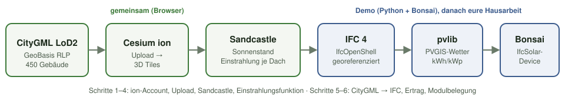

# PV-Potenzial von CityGML bis BIM – nur mit offener Software

Gastvortrag im Wahlmodul **Green Building Information Modeling**, Hochschule Mainz
Montag, 07.12.2026, 17:00–18:30 Uhr (online)

> Muss man Software kaufen, um herauszufinden, wie viel Solarstrom ein Dach liefert?
> Nein. In diesem Repo steckt der komplette Weg vom amtlichen 3D-Stadtmodell bis zum BIM-Modell mit PV-Belegung, und zwar ausschließlich mit offenen Werkzeugen.



| Schritt | Was | Werkzeug | Wer |
|---|---|---|---|
| 1 | Cesium-ion-Account anlegen | Browser | **ihr, vorab** ([Vorbereitung](00_vorbereitung.md)) |
| 2 | LoD2-Daten (CityGML) laden und in Cesium ion hochladen | ion | **gemeinsam** |
| 3 | Daten in Sandcastle anzeigen, Sonnenstand berechnen | CesiumJS | **gemeinsam** |
| 4 | Einstrahlung auf jede Dachfläche berechnen und einfärben | CesiumJS | **gemeinsam** (Mitmach-Code mit Lücken) |
| 5 | Ein Gebäude aus CityGML in ein echtes IFC-Modell umwandeln | Python, IfcOpenShell, Bonsai | Demo |
| 6 | Jahresertrag simulieren, Module aufs Dach legen | pvlib, IfcOpenShell, Bonsai | Demo, danach eure Hausarbeit |

## Inhalt

```
data/
  campus_lod2.gml            LoD2-Ausschnitt Campus HS Mainz + Bretzenheim (450 Gebäude)
  campus_roofs.geojson       1205 Dachflächen mit Neigung, Azimut, Fläche
  campus_roofs_pv.geojson    + Einstrahlung, Ertrag, Eignung (für Sandcastle)
  campus_roofs_pv.csv        dasselbe als Tabelle (Excel: Trennzeichen ;)
  poa_lookup.json            Jahreseinstrahlung/Ertrag nach Neigung x Azimut (Mainz)
  tmy_mainz.csv              Referenzwetterjahr (PVGIS) für Mainz
  haus_bretzenheim(_pv).ifc  Einfamilienhaus (Satteldach) als IFC, mit PV-Belegung
  hs_mainz_gebaeude(_pv).ifc Hochschulgebäude (Flachdach) als IFC, mit PV-Belegung
sandcastle/
  01_load_ion.js             eigenes ion-Asset laden, Attribute per Klick
  02_sun.js                  Sonnenstand über dem Campus
  schritt4/                  Einstrahlung in 4 Stufen, jede Stufe eine lauffähige Datei
    stufe0_start.js          drei Lücken, Dächer weiß
    stufe1_farbe.js          TODO 1 gelöst
    stufe2_normale.js        TODO 2 gelöst
    stufe3_einfallswinkel.js TODO 3 gelöst = Lösung
    README.md                die drei Code-Zeilen zum Kopieren
  make_stufen.py             erzeugt die Stufen aus schritt4/_vorlage.js
python/
  clip_citygml.py            Kachel zuschneiden
  citygml_roofs.py           Dachflächen aus CityGML -> GeoJSON
  pv_yield.py                Einstrahlung und Ertrag (pvlib, PVGIS-TMY)
  citygml_to_ifc.py          ein Gebäude -> georeferenziertes IFC4
  ifc_roofs.py               Dachflächen aus beliebigem IFC (z. B. Revit) bewerten
  module_layout.py           Modulbelegung als IfcSolarDevice ins IFC schreiben
```

## Schnellstart Sandcastle (Schritte 3–4)

1. https://sandcastle.cesium.com öffnen
2. Inhalt von [`sandcastle/schritt4/stufe0_start.js`](sandcastle/schritt4/stufe0_start.js) in den Editor kopieren. In der Token-Zeile die `//` entfernen und den Token aus dem Zoom-Chat einsetzen.
3. **Run** klicken. Mit der Zeitleiste die Uhrzeit verschieben. Am Anfang sind die Dächer noch weiß.
4. Die drei `TODO`s der Reihe nach lösen. Welche Zeile wodurch ersetzt wird, steht in [`sandcastle/schritt4/README.md`](sandcastle/schritt4/README.md). Wer hängen bleibt, fügt einfach die Datei der nächsten Stufe komplett ein, die letzte Stufe ist die Lösung.

## Schnellstart Python (Schritte 5–6)

```bash
cd python
pip install -r requirements.txt

# eigenes Revit-/Archicad-Modell bewerten:
python ifc_roofs.py ../pfad/zu/eurem_modell.ifc
python module_layout.py ../pfad/zu/eurem_modell.ifc eurem_modell_pv.ifc

# kompletter Weg ab CityGML (andere Gebäude-ID per Klick in Cesium ermitteln):
python citygml_roofs.py ../data/campus_lod2.gml ../data/campus_roofs.geojson
python pv_yield.py ../data/campus_roofs.geojson ../data/campus_roofs_pv.geojson
python citygml_to_ifc.py ../data/campus_lod2.gml DERPLP150000jSeO haus.ifc
python module_layout.py haus.ifc haus_pv.ifc
```

Die IFC-Dateien lassen sich in **Blender + Bonsai** öffnen (kostenlos, https://bonsaibim.org), ebenso in jedem anderen IFC-Viewer und in Revit.
Die Psets `PV_Potenzial`, `PV_Belegung` und `PV_Anlage` enthalten die Ergebnisse.

## Andere Orte

LoD2-Daten für ganz Rheinland-Pfalz gibt es frei als 2×2-km-Kacheln unter
`https://geobasis-rlp.de/data/geb3dlo/current/gml/LoD2_32_<E km>_<N km>_2_RP.gml`, wobei E und N gerade km-Werte in UTM32 sind.
Die anderen Bundesländer bieten ihre LoD2-Daten ebenfalls als Open Data an, z. B. Hessen, NRW, Bayern und Berlin.
Für einen anderen Ort müssen `LAT`/`LON` in `pv_yield.py` angepasst und `data/tmy_mainz.csv` gelöscht werden. Das Referenzjahr wird dann neu von PVGIS geladen.

## Was das Modell (noch) nicht kann – Diskussionsstoff

- **Verschattung**: Nachbargebäude, Bäume und Gauben werden bei der Jahreszahl nicht berücksichtigt. In Sandcastle sieht man die Schatten zwar, sie fließen aber nicht in die Berechnung ein.
- LoD2-Dächer sind generalisiert, Dachfenster, Gauben und Schornsteine fehlen. Deshalb gibt es einen pauschalen Belegungsgrad von 70 %.
- Statik, Brandschutzabstände, Denkmalschutz und Netzanschluss bleiben außen vor.
- Graue Energie und CO₂ der Module, also die Ökobilanz, ist die Brücke zu eurer Hausarbeit.

## Quellen und Lizenzen

- 3D-Gebäudemodelle LoD2: © GeoBasis-DE / LVermGeoRP (2026), [dl-de/by-2-0](https://www.govdata.de/dl-de/by-2-0), Ausschnitt und Weiterverarbeitung durch den Autor
- Wetterdaten: PVGIS © European Union, 2001–2026
- Code: MIT-Lizenz
